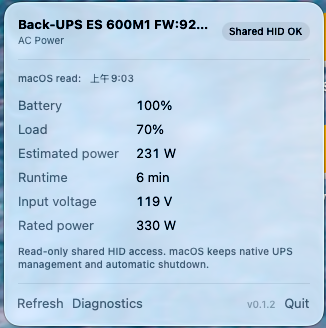
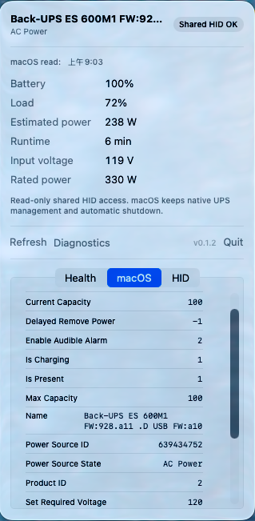

# APC UPS Monitor

<p align="left">
  <a href="README.md"><b>English</b></a> | <a href="README_zh.md"><b>简体中文</b></a>
</p>

A tiny, native macOS menu-bar monitor for APC Back-UPS (specifically tested on Back-UPS ES 600M1 / BE600M1).

<p align="center">
  
  &nbsp;&nbsp;&nbsp;&nbsp;
  
</p>

## Highlights & Features

- **Non-exclusive Shared Access**: Does not require `apcupsd` or NUT. Opens USB HID with `kIOHIDOptionsTypeNone` (shared, read-only) so macOS `ioupsd` retains native ownership and automatic shutdown features.
- **Real-time Metrics**: Displays live estimated power wattage (`watts = rated power × load %`), load percentage, input voltage, battery level, and runtime directly on the menu bar.
- **Process-isolated Refresh**: Separate worker processes handle Apple `IOPowerSources` and USB HID polling with a 5-second watchdog to guarantee that driver latency never freezes the UI.
- **Sleep & Wake Resilient**: Seamlessly pauses during system sleep and recovers immediately on wake without stale USB handles.
- **Built-in Diagnostics**: Inspect live macOS power source dictionary and raw USB HID elements directly from the UI.

## Run & Install

- **Option A (Command line build & install)**:
  ```bash
  # Build locally (creates APCUPSMonitor.app)
  ./build.sh

  # Build and install to /Applications
  ./build.sh install
  ```
- **Option B (Xcode)**:
  Open `APCUPSMonitor.xcodeproj` in Xcode and press Run.

> Note: The app sets `LSUIElement = true`, so it runs strictly in the macOS menu bar without showing in the Dock.

## Important Safety Check

After launching the app, verify that macOS still shows its native UPS entry and battery percentage in the menu bar / Energy settings. This app intentionally never uses `kIOHIDOptionsTypeSeizeDevice`.

If `Load` is shown as `—`, open **Diagnostics → HID** to inspect the raw usage/value list.

## 0.1.2 — Architecture & Recovery

- Native macOS and HID reads run independently in short-lived reader processes. Each read recreates the IOKit connection; a 5-second deadline kills a stuck reader without blocking the menu or the other data source.
- Native data polls every 2 seconds. Successful HID reads have a minimum 2-second interval; unavailable HID backs off for 30 seconds. Manual refresh immediately bypasses backoff.
- Polling uses `.common` run-loop modes, keeping updates alive while menus or tracking controls are active.
- Run fault/recovery regression tests with `./Tests/run.sh`.

CLI diagnosis modes (JSON output, no menu UI):
```bash
./APCUPSMonitor.app/Contents/MacOS/APCUPSMonitor --read-system
./APCUPSMonitor.app/Contents/MacOS/APCUPSMonitor --read-hid
```

## License

This project is licensed under the [MIT License](LICENSE).
